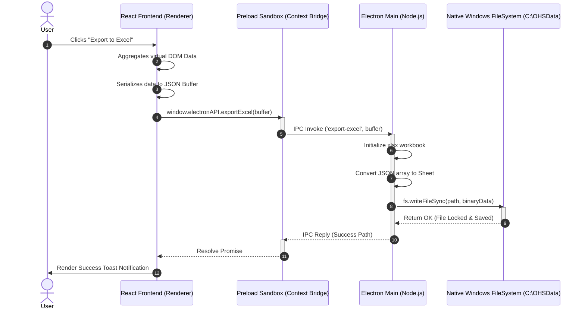
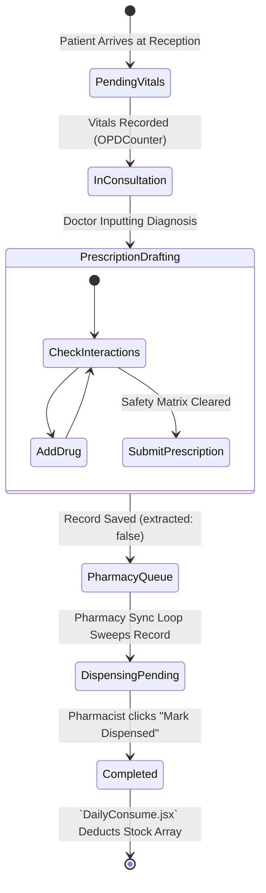
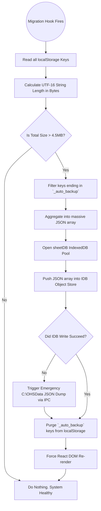

## 31. Advanced Subsystem Visual Mappings & Logical Algorithms

Rather than providing raw source code, this chapter maps out the exact logical execution paths, state machines, and Inter-Process Communication (IPC) pipelines that power the system's most complex behaviors.

### 31.1 The Electron IPC Bridge (React to Node.js Sequence)
The following sequence diagram maps the exact chronological flow of data when a user triggers an export operation. Because the React frontend is completely sandboxed for security, it cannot touch the Windows filesystem directly. It must serialize the data, pass it over the isolated `window.electronAPI` bridge, and await the Node.js Main Process to execute the native `fs.writeFileSync` operations.



*Figure 31.1: Electron IPC Bridge Export Sequence — React Renderer to Native Windows FileSystem*

### 31.2 The Patient Lifecycle State Machine
The following state diagram visualizes the strict lifecycle of a patient record. A record cannot jump from Registration directly to Dispensed without passing through the OPD assessment. The `extracted` boolean flag securely gates the transition between the OPD database and the Pharmacy queue.



*Figure 31.2: Patient Record State Machine — OPD Registration to Dispensing Completion*

### 31.3 LocalStorage to IndexedDB Data Migration Flowchart
Because JSPulse OHMS operates offline without a cloud backend, it relies heavily on local browser storage. The following flowchart demonstrates the autonomous quota-defense mechanism that prevents the `5MB QuotaExceededError` from crashing the application.



*Figure 31.3: LocalStorage to IndexedDB Quota-Defense Auto-Migration Flowchart*

### 31.4 The Offline AI Intent Classification Tree
The offline ChatBrain NLP engine replaces the need for cloud APIs during network outages. The following decision tree maps out how raw conversational English is tokenized and routed to the correct local database index.

```mermaid
graph TD
    UserQuery[Raw String: "How much Paracetamol is left in stock?"]
    UserQuery --> Tokenizer[Lowercase, Regex Strip Punctuation]
    Tokenizer --> TokenArray["[how, much, paracetamol, is, left, in, stock]"]
    
    TokenArray --> IntentMatcher{Regex Intent Matching}
    
    IntentMatcher -->|Matches 'stock'| StockLogic[Trigger Inventory Subsystem]
    IntentMatcher -->|Matches 'visit'| VisitLogic[Trigger Patient Log Subsystem]
    IntentMatcher -->|Matches 'excel'| ExcelLogic[Trigger Grid Command Subsystem]
    
    StockLogic --> FilterArray[Extract 'paracetamol' as subject]
    FilterArray --> LocalStorageRead[Read `cms_medstock_data`]
    LocalStorageRead --> SearchIndex[Fuzzy match 'paracetamol' against IDs]
    
    SearchIndex --> MatchFound{Match Found?}
    
    MatchFound -->|Yes| ConstructSuccess[Return: "Paracetamol currently has 450 units in stock."]
    MatchFound -->|No| ConstructFail[Return: "I couldn't find Paracetamol in the local inventory."]
    
    ConstructSuccess --> UIRender[Append AI message to ChatAssistant State]
    ConstructFail --> UIRender
```

*Figure 31.4: Offline AI Intent Classification Decision Tree for Natural Language Queries*
