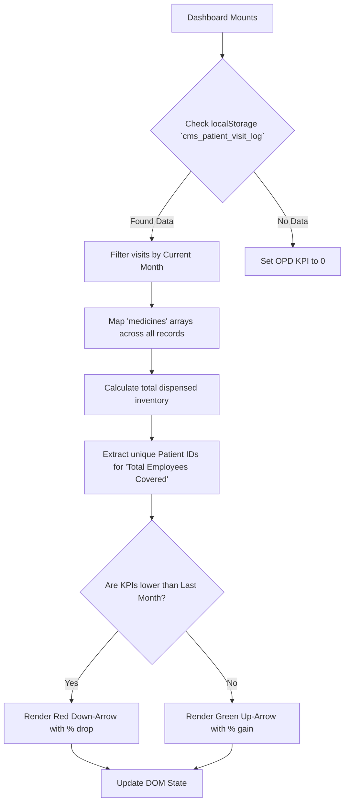
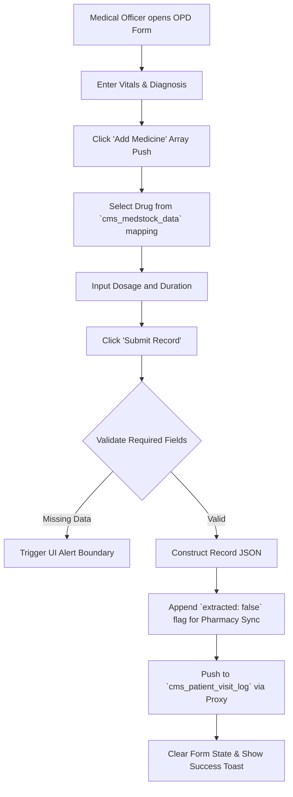
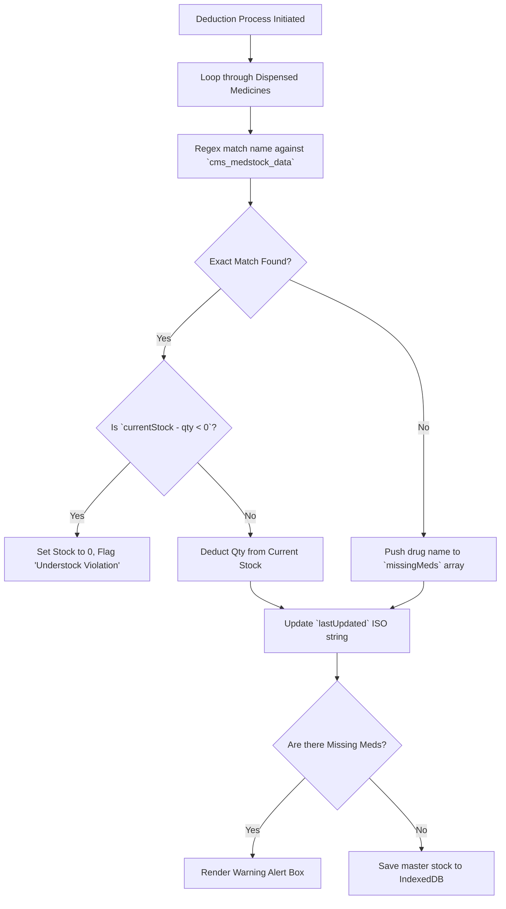
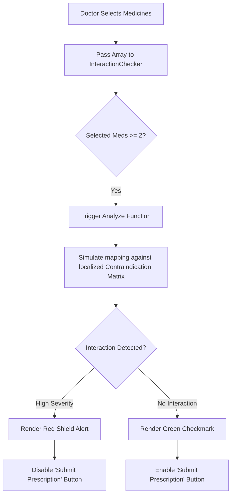
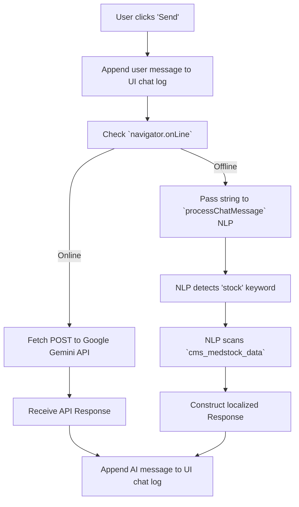

## 20. Exhaustive UI Component: Dashboard & Global Navigation
**Location:** `src/components/Dashboard.jsx`, `src/components/Navbar.jsx`

### Comprehensive Overview
The Dashboard acts as the central intelligence hub of JSPulse OHMS. It features dynamic KPI metrics, a 6-month predictive trend chart, and vital warnings. The Navbar provides global routing and triggers the universal search index.

### Advanced State Automation Flowchart


*Figure 20.1: Dashboard KPI State Calculation and Visual Arrow Alert Logic*

### Granular Button & Element Catalog
*   **[Global Search Bar (CTRL+K)]:** Triggers the `GlobalSearch.jsx` debounced indexer.
*   **[Theme Toggle (Sun/Moon)]:** Dispatches an event to flip the global CSS `--bg` variables.
*   **[Refresh Analytics Button]:** Bypasses the 5-minute cache and forces an immediate read of all `localStorage` keys, re-running the aggregation loops.
*   **[Export Summary to Excel]:** Maps the KPI states to an array buffer and fires the `exportUtils.js` IPC bridge.

---

## 21. Exhaustive UI Component: OPD Counter & Prescription
**Location:** `src/components/clinical/OPDCounter.jsx`

### Comprehensive Overview
The Out-Patient Department (OPD) counter is the entry point for medical officers to record vitals and issue electronic prescriptions. It leverages dynamic arrays to handle multi-drug prescriptions within a single JSON object.

### Advanced Prescription Automation Flowchart


*Figure 21.1: OPD Patient Encounter and Electronic Prescription Flow*

### Granular Button & Element Catalog
*   **[Add Medicine Button]:** Pushes an empty object `{name: '', dosage: '', qty: 1}` to the React state array, dynamically rendering a new row in the UI.
*   **[Remove (Trash Icon) Button]:** Splices the medicine array at the specific index, updating the DOM instantly.
*   **[Save Record Button]:** Commits the entire patient object to the local database proxy.
*   **[Print Prescription Button]:** Renders `OPDCardPrintable.jsx` in a hidden iframe and triggers the Electron `printToPDF` native dialogue.

---

## 22. Exhaustive UI Component: Pharmacy Dispense Sync
**Location:** `src/components/DispenseMedicine.jsx`

### Comprehensive Overview
The Dispense module operates autonomously using a background polling engine. It removes the need for pharmacists to manually refresh their queues by actively sweeping the OPD database for unfulfilled prescriptions.

### Background Sync & Dispense Flowchart
```mermaid
graph TD
    A[Component Mounts] --> B[Start `setInterval(10000)`]
    B --> C[Read `cms_patient_visit_log`]
    C --> D{Is `extracted == false`?}
    D -->|Yes| E[Copy record to `cms_dispense_log` state]
    E --> F[Mutate OPD record `extracted: true`]
    D -->|No| G[Ignore Record]
    F --> H[Pharmacist views new Pending request]
    H --> I[Pharmacist clicks 'Mark Dispensed']
    I --> J[Change status to 'Completed']
    J --> K[Trigger `DailyConsume.jsx` deduction pipeline]
```

*Figure 22.1: Pharmacist Dispense Queue Polling and Sweeping Loop*

### Granular Button & Element Catalog
*   **[Auto-Sync Toggle]:** Clears or re-initializes the 10-second `setInterval` polling hook.
*   **[Mark as Dispensed Button]:** Triggers a state mutation, changing the badge from Yellow (Pending) to Green (Completed) and pushing the update to disk.
*   **[View Details (Eye Icon)]:** Opens a modal displaying the doctor's notes and the exact medicine array required.

---

## 23. Exhaustive UI Component: Inventory Consumption
**Location:** `src/components/clinical/DailyConsume.jsx`

### Comprehensive Overview
This module is the backbone of the physical pharmacy. It maps dispensed virtual records against the master stock ledger, deducting quantities and handling graceful fallbacks when human error leads to mismatched database entries.

### Stock Deduction Safety Flowchart


*Figure 23.1: Inventory Stock Deduction Verification and Safety Loop*

### Granular Button & Element Catalog
*   **[Deduct & Save Inventory Button]:** Executes the complex mapping algorithm to subtract stock values based on the day's dispensing logs.
*   **[Manual Adjustment Button]:** Opens a highly-privileged modal allowing the pharmacist to override quantities directly.
*   **[Export Consumption Report]:** Dumps the day's deductions into an Excel spreadsheet array buffer.

---

## 24. Exhaustive UI Component: AI Interaction Checker
**Location:** `src/components/InteractionChecker.jsx`

### Comprehensive Overview
A critical safety feature utilizing offline deterministic mapping to prevent lethal drug interactions. If a doctor prescribes contraindicating medications, this UI boundary flashes warnings before the record can be saved.

### Interaction Logic Flowchart


*Figure 24.1: Deterministic Multi-Drug Clinical Safety Contraindication Matrix Loop*

### Granular Button & Element Catalog
*   **[Medicine Selection Pills]:** Toggle buttons that push or filter the specific drug ID into the `selectedMeds` array.
*   **[Check Interactions Button]:** A debounced trigger that runs the safety matrix algorithm.
*   **[Override Warning (Admin Only)]:** A restricted red button that forces the prescription through despite warnings, logging the admin's ID.

---

## 25. Exhaustive UI Component: Offline AI ChatBrain Interface
**Location:** `src/components/ChatAssistant.jsx`

### Comprehensive Overview
The floating AI chat widget provides a conversational interface to the system. It handles network state gracefully, seamlessly switching between local NLP vectors and external Google Gemini APIs without user intervention.

### Neural Pipeline Flowchart


*Figure 25.1: Conversational Query Routing and Offline NLP Local Scans*

### Granular Button & Element Catalog
*   **[Floating Chat Icon]:** Toggles the CSS `bottom` property to slide the chat window into view.
*   **[Send Message Button (Arrow)]:** Triggers the `handleSubmit` function, locking the input field while processing.
*   **[Clear Conversation Button]:** Wipes the `messages` array from React state, resetting the contextual memory.

---

## 26. Exhaustive UI Component: Data Backup & System Health
**Location:** `src/components/clinical/SystemHealthTool.jsx`

### Comprehensive Overview
The ultimate fail-safe utility. It monitors the `localStorage` byte quotas dynamically and forces hard migrations to IndexedDB to prevent the dreaded `QuotaExceededError` that causes web apps to crash.

### Auto-Migration Health Flowchart
```mermaid
graph TD
    A[SystemHealthTool Mounts] --> B[Iterate over all keys in localStorage]
    B --> C[Calculate UTF-16 byte size per key]
    C --> D[Sum total bytes / (1024*1024) for MB]
    D --> E{Is usage > 4.5MB?}
    E -->|Yes| F[Trigger Critical Warning State]
    F --> G[Extract all `_auto_backup` historical keys]
    G --> H[Push historical data to `sheetDB` IndexedDB]
    H --> I[Delete historical keys from localStorage]
    I --> J[Recalculate Quota]
    E -->|No| K[Render Green 'Healthy' Badge]
    J --> K
```

*Figure 26.1: Local Storage Quota Guard and IndexedDB Auto-Migration Pipeline*

### Granular Button & Element Catalog
*   **[Estimate Quota Button]:** Runs the heavy `for...in` loop to calculate exact UTF-16 string sizes.
*   **[Force Migrate to IDB Button]:** Bypasses the 4.5MB threshold and immediately flushes historical logs to IndexedDB.
*   **[Clear System Cache Button (DANGER)]:** Executes `localStorage.clear()` after forcing an emergency JSON file dump to the Windows `C:\OHSData` directory.

---

## 27. Exhaustive UI Component: Custom Spreadsheet Subsystem
**Location:** `src/components/CustomSheets.jsx` & `ExcelGrid.jsx`

### Comprehensive Overview
The spreadsheet engine provides an Excel-like interface natively within the React application. It handles 10,000+ cells using DOM virtualization, inline formula parsing, and strict column typing.

### Inline Cell Edit Automation Flowchart
```mermaid
graph TD
    A[User Double-Clicks Cell] --> B[Transform `<td>` into `<input>`]
    B --> C[User Types Data]
    C --> D[User presses 'Enter' or 'Tab']
    D --> E[Trigger `handleCellChange`]
    E --> F[Deep Clone matrix for Undo Stack]
    F --> G{Does string start with '='?}
    G -->|Yes| H[Pass string to `evaluateFormula` Recursive Parser]
    G -->|No| I[Cast to Column Type (Number/String)]
    H --> J[Return computed float]
    I --> K[Update React State Matrix]
    J --> K
    K --> L[Proxy synchronizes matrix to Disk]
```

*Figure 27.1: ExcelGrid Inline Cell Modification and State Intercept Loop*

### Granular Button & Element Catalog
*   **[Add Column Button]:** Pushes a new `{field: 'col_X', headerName: 'New Col'}` object to the schema array.
*   **[Add Row (Bottom) Button]:** Pushes an empty `{}` object to the matrix data array.
*   **[Formula Helper Toggle]:** Highlights all cells currently containing computed `=SUM()` functions in light blue.
*   **[Export Matrix Button]:** Compiles the multi-dimensional array into an XLSX workbook via `exportUtils.js`.
