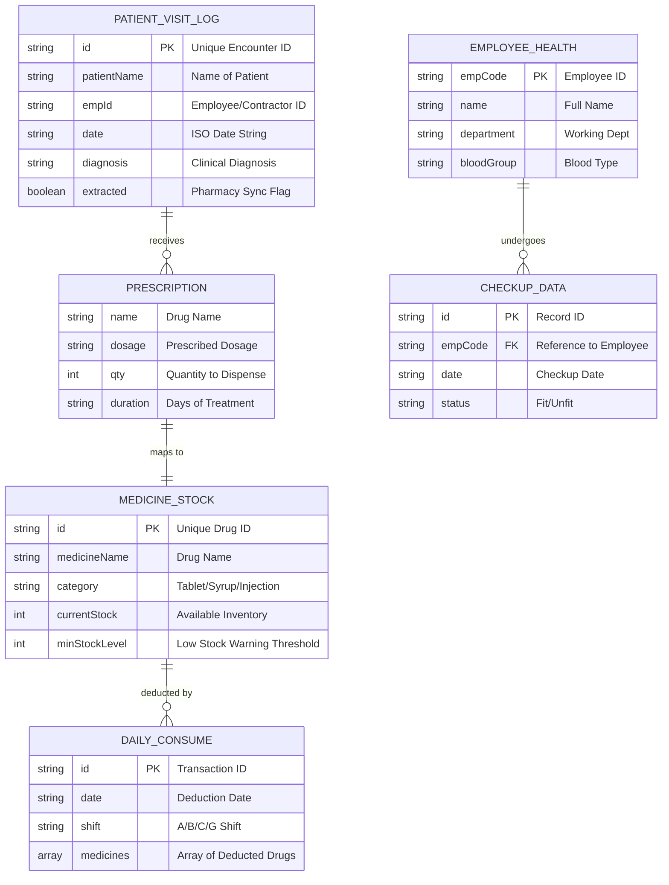

## 7.5 Visual System Diagrams for Structural Clarity

To provide a clear, high-level understanding of the JSPulse OHMS software before diving into the exhaustive algorithm and component documentation, this section provides comprehensive architectural mappings. These diagrams illustrate exactly how the database collections interact and how the user interface components are structured.

### Database Entity-Relationship (ER) Schema
The following Entity-Relationship diagram maps out the core NoSQL-style JSON collections stored within the custom `localStorage` proxy engine, detailing how primary entities (like Patients and Employees) link directly to Inventory and Interaction ledgers.

*Figure 5.1: Database Entity-Relationship (ER) Schema*

### React UI Component Hierarchy Map
The following structural flowchart maps the entire React DOM tree. It illustrates the routing hierarchy from the global application wrapper down into the highly specific clinical and pharmacy sub-modules.

```mermaid
graph TD
    App[App.jsx - Global Router & Context Provider]
    App --> Navbar[Navbar.jsx - Global Navigation]
    Navbar -.-> GlobalSearch[GlobalSearch.jsx - CTRL+K Indexer]
    
    App --> Dashboard[Dashboard.jsx - Main KPI Analytics]
    
    App --> ClinicalWrapper[Clinical Views Container]
    
    ClinicalWrapper --> OPD[OPDCounter.jsx - Prescribing Engine]
    ClinicalWrapper --> Dispense[DispenseMedicine.jsx - Pharmacy Sync Queue]
    ClinicalWrapper --> Consume[DailyConsume.jsx - Stock Deduction Engine]
    
    ClinicalWrapper --> Inventory[Inventory Subsystems]
    Inventory --> Stock[MedicineStockRegister.jsx]
    Inventory --> Checker[InteractionChecker.jsx - Safety Matrix]
    
    ClinicalWrapper --> PatientData[Patient Data Ledgers]
    PatientData --> Visits[PatientVisitLog.jsx]
    PatientData --> Vitals[VitalSignsChart.jsx]
    PatientData --> Injury[InjuryReportLog.jsx]
    PatientData --> FirstAid[FirstAidBoxTracker.jsx]
    PatientData --> Ambulance[EmergencyAmbulanceLog.jsx]
    
    ClinicalWrapper --> EmployeeData[Occupational Health Subsystems]
    EmployeeData --> EmpHealth[EmployeeHealthRecords.jsx]
    EmployeeData --> Checkups[AnnualHealthCheckup.jsx]
    EmployeeData --> OccDisease[OccupationalDiseaseRegistry.jsx]
    
    ClinicalWrapper --> Tools[System & Reporting Tools]
    Tools --> MIS[MonthlyMISReport.jsx - Analytics Aggregator]
    Tools --> Excel[ExcelGrid.jsx - Virtual DOM Spreadsheet Engine]
    Tools --> SystemHealth[SystemHealthTool.jsx - DB Migration Engine]
    
    App --> Chat[ChatAssistant.jsx - Offline NLP Engine]
```

*Figure 5.2: React UI Component Hierarchy Map*
